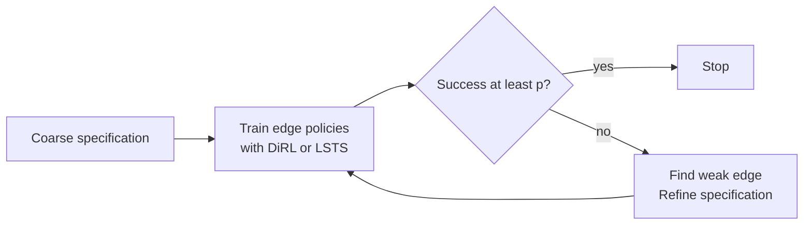

# AutoSpec — Expanded Implementation Notes

## 1. Core answer (unchanged from lecture notes)

AutoSpec repairs a weak task specification during training, with no human needed. It makes
the specification stricter and more detailed. A trajectory that satisfies the new
specification also satisfies the old one.

**Verdict.** The idea is good and the soundness result is useful. The experiments are small.
The method fails when the base learner finds no successful trajectory. Use AutoSpec as a
wrapper around DiRL. Do not assume a sound refinement is also a useful refinement.



---

## 2. Formal objects you need to implement

### 2.1 MDP and trajectories
`M = (S, A, P, R, γ)`. `η : S → [0,1]` is the initial-state distribution. A trajectory
`ζ = s0,a0,s1,a1,…`. `Zf` = finite prefixes. A pure policy `π : Zf → A`.

### 2.2 SpectRL grammar (formal)
```
b := a | b1 ∧ b2 | b1 ∨ b2                      (predicates, a = atomic predicate)
φ := achieve b | φ ensuring b | φ1;φ2 | φ1 or φ2  (specification formulas)
```

### 2.3 Abstract graph (Definition 1)
`G = (V, E, β, s, t)`: a DAG.
- `V`: finite set of vertices, each a checkpoint region.
- `E`: finite set of edges; each edge is a reach-avoid task from source to target vertex.
- `β : V ∪ E → 2^S`: labels vertices with target-region state sets and edges with
  safe-region state sets.
- `s`: source vertex, with `β(s) = support(η)`.
- `t`: target (goal) vertex.

`ζ ⊨ G` iff `ζ` induces a path from `s` to `t` in `G` and satisfies every traversed edge's
reach-avoid task (reach the target vertex's region while staying inside the edge's safe
region). **Key equivalence (Jothimurugan et al. 2021):** for the graph `G` built from `φ`,
`ζ ⊨ φ ⇔ ζ ⊨ G`. So the whole implementation works on the graph, not the logic string.

### 2.4 Specification refinement (Definition 2)
`φ_r` refines `φ` iff for every trajectory `ζ`: `(ζ ⊨ φ_r) ⇒ (ζ ⊨ φ)`.
By the equivalence above, this reduces to a graph-level condition: `(ζ ⊨ G_r) ⇒ (ζ ⊨ G)`.
This is the *only* thing each refinement procedure has to preserve.

---

## 3. Algorithm 1 — the AutoSpec main loop (implement this first)

**Inputs:** MDP `M`, specification `φ`, threshold `p ∈ [0,1]`, spec-guided RL algorithm `A`
(must be SpectRL-compatible, i.e. it consumes an abstract graph and returns one policy per
edge — DiRL or LSTS both qualify).

```
G ← abstract_graph(φ)
Π ← A(G)                                   # one policy per edge, or Null if A gave up
for e = u → u' in G (topological order):
    π_e ← Π[e]
    if π_e is not Null and P_hat(π_e) < p:
        ζ ← sample_trajectories(π_e)        # rollout the learned edge policy
        if LEARNPOLICY(e, SEQREFINE(e, G, ζ)) > p:
            G ← SEQREFINE(e, G, ζ)
        elif LEARNPOLICY(e, ADDREFINE(e, G, ζ)) > p:
            G ← ADDREFINE(e, G, ζ)
        elif LEARNPOLICY(e, PASTREFINE(e, G, ζ)) > p:
            G ← PASTREFINE(e, G, ζ)
        elif LEARNPOLICY(e, ORREFINE(e, G, ζ)) > p:
            G ← ORREFINE(e, G, ζ)
        # else: no refinement clears threshold, keep original edge, move on
        Π ← A(G)                            # relearn ALL edge policies on the new graph
return G, Π
```

Implementation notes:
- `P_hat(π_e)` is estimated empirically by rollout counting, **not** analytically (1000
  rollouts per edge in all experiments).
- `LEARNPOLICY(e, G')` trains a policy for edge `e` on candidate graph `G'` and returns its
  estimated success probability — this is how each candidate refinement is *scored* before
  being committed. This is the expensive inner loop: each of the up-to-4 operator attempts
  costs one extra training run.
- The four operators are tried **in a fixed order**: SeqRefine → AddRefine → PastRefine →
  OrRefine. This order is deliberate: smallest structural change first (relabeling), largest
  last (adding graph edges). The first operator whose candidate clears `p` is committed; the
  rest are not tried for that edge.
- After a refinement is committed, `A` **retrains all edges of the whole graph**, not just
  the refined one — but see §6 (Computational Overhead) for why this is cheaper than it
  sounds in practice.

---

## 4. The four refinement operators — full pseudocode

All four take `(e = u → u', G, ζ)` where `ζ` is a set of sampled trajectories of the current
(unsatisfactory) policy for edge `e`, and return a new graph `G'`.

### 4.1 SeqRefine (Algorithm 4) — tighten the predicates on an existing edge

SeqRefine calls two independent sub-procedures and applies both.

**ReachRefine (Algorithm 2)** — shrink the *target* region:
```
Require: b = β(u'), ζ
Sr ← { s : s ∈ b ∩ ζ }                 # states in the target region actually visited
b_r ← b ∩ ConvexHull(Sr)
return b_r
```
Effect: removes portions of the target region the agent never actually reaches (e.g. an
unreachable sub-room). Purely geometric — no learning inside this call.

**AvoidRefine (Algorithm 3)** — grow the *avoid* (shrink the *safe*) region:
```
Require: c = β(e), ζ         # c = safe region for edge e
Or ← {}
for ζ_i in ζ:
    if ζ_i[-1] ∉ c:                                  # trajectory ended unsafe
        Or ← Or ∪ { s_j ∈ ζ_i : (len(ζ_i) - j) ≤ k }  # last k states of that trajectory
c_r ← c \ ConvexHull(Or)
return c_r
```
`k` is a hyperparameter (the paper uses `k = 10` in the reported test) controlling how much
of the trajectory tail near the failure is blocked out.

**SeqRefine itself:**
```
Require: e = u → u', G, ζ
b ← β(u');  c ← β(e)
b_r ← ReachRefine(b, ζ)
c_r ← AvoidRefine(c, ζ)
u_r ← new vertex with β(u_r) = b_r
e_r ← new edge u → u_r with β(e_r) = c_r
G' ← G with e replaced by e_r  (and u' replaced by u_r on this path)
return G'
```

### 4.2 AddRefine (Algorithm 5) — insert a waypoint to shorten a long edge

```
Require: e = u → u', G, ζ
Sr ← {}
for ζ_i in ζ:
    if ζ_i ⊨ e:                              # only successful trajectories
        Sr ← Sr ∪ { ζ_i[ len(ζ_i)//2 ] }      # midpoint state
b_r ← ConvexHull(Sr) ∩ β(e)
u'' ← new vertex, β(u'') = b_r
e'' ← u → u'',  β(e'') = β(e)
e'  ← u'' → u', β(e')  = β(e)
G' ← G with e replaced by [e''; e']           # sequential composition
return G'
```
Risk called out explicitly by the paper: this needs at least some *successful*
trajectories to extract midpoints from — with zero successes it cannot fire.

### 4.3 PastRefine (Algorithm 6) — cut the bad part of the source region

```
Require: e = u → u', G, ζ
S ← {};  Sr ← {}
for ζ_i in ζ:
    S ← S ∪ { ζ_i[0] }                        # all start states seen
    if ζ_i ⊨ e:
        Sr ← Sr ∪ { ζ_i[0] }                  # start states of successful trajectories
Fit a separating hyperplane H between Sr and (S \ Sr)   # e.g. linear SVM / logistic reg.
b_r ← { s ∈ S : H(s) ≥ 0 }                    # keep the "good" side
u* ← new vertex, β(u*) = b_r, with the SAME incoming edges as u
e_r ← u* → u', β(e_r) = β(e)
G' ← G with e replaced by e_r  (u itself and its other outgoing edges are untouched)
return G'
```
The paper does not specify which classifier to use for `H` — any linear separator (SVM,
logistic regression, perceptron) is consistent with the description. Note this is the one
operator with an explicitly acknowledged geometric limitation: **a single hyperplane cannot
separate a region split by walls into disconnected good/bad pieces.**

### 4.4 OrRefine (Algorithm 7) — route around a blocked edge via an existing sibling

```
Require: e = u → u', G, ζ
E ← { e_i = u_i → u' : e_i ∈ G }              # all OTHER parents of u' (existing edges)
for e_i in E:
    e_new ← u → u_i,  β(e_new) = β(e)
    β(e_i) ← β(e) ∩ β(e_i)                    # tighten the existing edge in-place
    G ← G ∪ { e_new }                         # add the new edge; e_i already exists
    # (test path u → u_i → u' against threshold; iterate to ancestors of u_i if it fails)
return G
```
This is the only operator that does **not** remove/replace `e`; it adds a parallel route
`u → u_i → u'` reusing existing vertices, and keeps `e` in the graph unmodified alongside
the new path (the loop in Algorithm 1 will re-check success once `A` relearns the whole
graph). If the direct connection to `u_i` still fails, recurse into `u_i`'s own ancestors.

### 4.5 Which operator fixes which symptom (diagnostic table)

| Symptom on edge `u → u'` | Likely cause | Operator |
|---|---|---|
| Agent ends up in a part of the target it can't leave | Target region too big | SeqRefine (ReachRefine) |
| Agent leaves the safe region at the same spot repeatedly | Safe region too loose | SeqRefine (AvoidRefine) |
| Edge is long; policy can't learn it | Task too long for one policy | AddRefine |
| Some start states always succeed, others always fail | Start region is mixed | PastRefine |
| Edge is blocked / near-zero success for all starts | Wrong route entirely | OrRefine |

---

## 5. Soundness proof (Theorem 1) — what your implementation must guarantee

**Claim:** for any edge `e` and any of the four operators, if it returns `G_r`, then
`(ζ ⊨ G_r) ⇒ (ζ ⊨ G)` for every trajectory `ζ`. Combined with `ζ ⊨ φ ⇔ ζ ⊨ G`, this gives
`(ζ ⊨ φ_r) ⇒ (ζ ⊨ φ)`, i.e. Definition 2.

Proof sketch per operator (this is the *invariant* each implementation must not violate):

- **SeqRefine.** `G_r` has the same vertex/edge set as `G`; only `β_r(u') ⊆ β(u')` and
  `β_r(e) ⊆ β(e)` change (both are set-intersections/subtractions of the original sets).
  Any trajectory meeting the tighter target/safe sets automatically meets the looser
  originals.
- **AddRefine.** The new pair `e''; e'` both carry `β(e) ` as their safe region, and forces
  the agent to pass through `u''` en route to `u'`. Any trajectory satisfying the two-hop
  path also satisfies the original reach-avoid task for `e` (visiting an intermediate point
  under the same safety constraint doesn't loosen anything).
- **PastRefine.** `β(u*) = b_r ⊆ β(u)`. A trajectory starting in the refined (smaller)
  source region starts in a state that was valid under the original specification too.
- **OrRefine.** The new edge `e_new` carries `β(e)` unchanged, and `e_i` is only tightened
  (`β(e_i) ∩=` the old value), never loosened. Both `u_i` and `u'` were already vertices of
  `G`, and edge `u_i → u'` already existed, so the two-hop path `u → u_i → u'` is a
  legitimate route through the *original* graph's structure — nothing outside `G`'s vertex
  or safety constraints is introduced. *(Flagged in the lecture notes as `[check]` — this is
  the one case that is more of a structural argument than a set-containment argument like the
  other three; worth re-deriving carefully if you rely on it formally.)*

**Practical corollary you should keep in mind while coding:** soundness is a *safety*
property only. An operator that returns the empty set is trivially "sound" (vacuously true)
but useless. Nothing in the algorithm measures how much useful behavior survives a
refinement — that's a design gap to be aware of, not a bug to fix.

**Completeness:** the paper explicitly disclaims completeness. Reachability satisfaction is
undecidable in general continuous-state MDPs (cited via Kaminski & Katoen 2015 on almost-sure
termination — the paper flags this citation as worth a careful read, since that result is
about program termination and the mapping to this exact decision problem isn't spelled out).
So: no algorithm can be both sound and complete here, and AutoSpec deliberately picks sound.

---

## 6. Training loop mechanics, hyperparameters, and cost model

### 6.1 Edge-policy learner (used for both `A(G)` and `LEARNPOLICY`)
- Algorithm: **PPO** (stable-baselines3 implementation).
- Network: 2 fully-connected layers, 64 units each.
- Learning rate: `0.0003`.
- `n_steps`: `2048`.
- Batch size: `64`.
- Epochs per update: `10`.
- Discount `γ`: `0.99`.

### 6.2 AutoSpec-level hyperparameters
- Satisfaction threshold `p`: `0.99` in **every** experiment (deliberately strict, chosen so
  that even small guidance gains are visible in the curves — not tuned per task).
- `k` (AvoidRefine tail length): `10` in the reported avoid-refinement test.
- Number of trajectories sampled per refinement attempt: left as an unspecified
  hyperparameter in the main text — you'll need to choose this yourself (their appendix
  experiments imply hundreds are enough for the small 9-rooms/100-rooms domains).
- Edge evaluation for success-probability estimates: **1000 rollouts per edge**.
- Final reported success probability = **product of edge success probabilities along the
  best start→goal path** in the (possibly refined) graph.
- 5 random seeds per experiment; plots report mean ± variance across seeds.
- Training-curve x-axis points correspond to independently trained policies at fixed step
  counts (e.g. 80k / 100k / 120k steps), not a single continuously-trained run.

### 6.3 Computational overhead accounting
```
T_total = T_base + Σ_{e ∈ R} T_e
```
where `R` is the set of edges that actually got refined (typically small relative to the
whole graph) and `T_e` is the extra training cost attributable to edge `e`'s refinement.
Empirically `T_total ≤ 2·T_base`. Concretely in the 100-rooms experiments: baseline ≈ 240 s
to train the 8 fixed edges; AutoSpec averaged 390 ± 42 s — i.e. the cost of training 4–7
extra refinement edges per seed, with variance driven by topological differences across
randomized layouts. So AutoSpec does **not** retrain from scratch on every refinement in
terms of asymptotic cost — cost scales with the number of detected bottleneck edges, not
with global state-space size — even though the pseudocode's `Π ← A(G)` line looks like a
full graph retrain (in practice `A` can warm-start unaffected edges).

### 6.4 Algorithm-dependent effectiveness: why base-algorithm choice matters
- **DiRL** (Dijkstra-style systematic graph search): explores edges roughly in order of
  estimated difficulty, so each edge accumulates enough trajectory data before refinement is
  attempted. AutoSpec+DiRL raised 100-rooms success from ≈0% to ≈60%.
- **LSTS** (multi-armed-bandit edge selection): spreads exploration effort across *all*
  edges simultaneously, so under a hard multi-branch spec, some edges (e.g. edges into
  M4/M5/Goal in the 100-rooms test) get **0% success and literally zero successful
  trajectories** — with no successful samples, ReachRefine/AddRefine/PastRefine/OrRefine all
  have nothing to compute a convex hull or hyperplane from. AutoSpec correctly reports it
  cannot refine, rather than fabricating a refinement. **Implementation implication:** guard
  every operator against empty-sample inputs and treat "0 successful trajectories" as a hard
  stop, not an edge case to silently paper over.

---

## 7. Procedural environment generation (Appendix A.3.1–A.3.4) — for reproducing the
randomized 100-rooms robustness test

Grid: `10×10` rooms, each room `8.0×8.0` units. Region set
`R = {Start, Goal, M1, M2, MG, MG1, MG2}`; each region occupies a `2×2` block of contiguous
rooms.

**Step 1 — Start/Goal placement.** Restrict Start/Goal to opposite grid corners to force
traversal complexity:
```
(Pos_start, Pos_goal) ~ Uniform({ (corner_TL, corner_BR), (corner_TR, corner_BL) })
```

**Step 2 — Intermediate region placement.** For each remaining region, sample a `2×2` block
uniformly from the valid grid cells **not already occupied** by a placed region:
```
Pos_r ~ Uniform( G_valid \ ⋃_{r' already placed} Area(r') )
```
ensuring no two regions overlap.

**Step 3 — Stochastic connectivity.** For every pair of grid-adjacent rooms `(u, v)`, place a
connecting door as an independent Bernoulli trial:
```
P(Door_{u,v}) = 0.5
```

Result per seed: a distinct wall/door layout and distinct region placement, but the same
*topological* specification structure as Figure 3's 100-rooms DAG:
`φ = φ_start ; (φ_m1 or φ_m2) ; φ_m3 ; (φ_m4 or φ_m5) ; φ_goal`.

**Observed failure/repair pattern in this environment (useful for validating your own
implementation against the paper's qualitative claims):**
- *Bridge bottleneck*: in ~80% of seeds, the `MG → MG1` transition collapses to 10–15%
  success even though `MG` itself is reached >90% of the time (narrow/non-linear randomized
  passages). `AddRefine` (waypoint `MG → MG_add → MG1`) or `ReachRefine` (tighter target)
  raise this specific edge to 50–70%.
- *Corridor switching*: when the `MG1` branch stays stochastically blocked (<5% success)
  even after refinement, AutoSpec's search (via the graph relearn + threshold check, not a
  separate mechanism) effectively abandons that branch and the `MG → MG2` alternative is
  discovered and optimized instead (>78% local success). This "switching" is an emergent
  effect of the main loop, not a fifth operator — no extra code needed beyond Algorithm 1.
- Reported end-to-end plateau under randomization: ≈50% (vs. ≈20% baseline DiRL, ≈60% on the
  fixed non-randomized 100-rooms layout) — randomized wall geometry genuinely caps achievable
  success, it isn't a refinement-process failure.

---

## 8. Environment specs used for the individual-operator experiments (Sec. 4.3 + App. A.3.6)

**9-rooms:** A 3×3 grid of rooms with walls and doors between adjacent rooms; regions such
as START, MID and GOAL are rectangular zones inside this grid. 4-D continuous state
`(x, y, θ, d) ∈ R⁴` (position, angle-to-goal, distance-to-goal); 2-D continuous action
`(v, θ) ∈ R²` (speed, heading); point-mass dynamics `s' = s + (v·cos θ, v·sin θ)` with no
physics engine. Start sampled from the source vertex's region, goal sampled from the target
vertex's region. This environment is used for all of the individual-operator tests (trap
state, narrow door, long corridor, mixed start, two-path).

**100-rooms:** The same style of environment scaled to a 10×10 grid of rooms (each room
8×8 units). See §7 for the fixed layout, the procedural generator, and the shared spec shape
`Start → M1-or-M2 → MG → MG1-or-MG2 → Goal`. Used to test whether refinement still works
when the state space is too large to explore exhaustively.

**PandaGym (reach task):** robotic arm holding an object; task = place it at a target
location; state = 3-D gripper position + goal position; the "invisible wall" is a safety
region the agent cannot directly observe, motivating exactly the kind of refinement
AutoSpec automates. Spec used:
`(reach red-region avoid wall); (reach green-region avoid wall)`.
ReachRefine fires on edge 1 (exclude unreachable red-region parts behind the wall);
PastRefine fires on edge 2 (partition approach angles from red-region into
successful/failing sets).

**Hardware used for all experiments:** i7-8750H, 32 GB RAM, no GPU — i.e. these are
CPU-trainable toy-scale experiments, not large-scale RL; a from-scratch reimplementation
should be tractable on modest compute.

---

## 9. Known limitations to carry into your implementation (Sec. 3.5 / A.4)

1. **Sample-starved edges can't be refined** — if the base learner gets literally zero
   successful trajectories, none of the four operators have data to work with (see LSTS
   case above). Implement this as an explicit "cannot refine" return path, not a crash.
2. **Geometry is simple** — convex hulls (Reach/Avoid/Add) and a single hyperplane (Past)
   assume convex/linearly-separable regions. Real, wall-fragmented rooms can violate this;
   the paper flags PastRefine in particular as unable to separate wall-split regions.
3. **Greedy, non-optimal search** — Algorithm 1 commits to the *first* candidate refinement
   that clears `p`, in the fixed operator order; it never compares candidates against each
   other or checks whether the choice helps *final*, whole-graph success.
4. **Shrink-only** — every operator narrows a region or restricts to existing structure;
   none can *grow* a region back once shrunk, so an overly aggressive refinement is
   effectively permanent within a run.
5. **Only `p = 0.99` tested** — no ablation over the threshold value.
6. **Small-scale validation** — 5 seeds, 2D-ish grid worlds plus one ~6-DoF manipulation
   task.
7. **Finite-trajectory / finitary-LTL only** — AutoSpec needs finite witnesses of
   satisfaction, so it's restricted to SpectRL (a finitary LTL fragment). Extending to
   infinite-horizon ω-regular specs is future work; the paper sketches a
   finite-prefix-plus-cyclic-suffix decomposition as the likely path, with the cyclic part
   requiring new witness machinery this implementation doesn't cover.
8. **Not optimality-guaranteed** even when a refinement is found — no guarantee the chosen
   refined predicate is the *tightest* sound one.

---

## 10. Minimal build checklist (from-scratch implementation order)

1. Predicate/labeling representation: state → set membership tests (`β`); atomic predicates
   as boolean functions over `S`.
2. Abstract-graph data structure: DAG with `β` on vertices and edges; SpectRL string → graph
   compiler (or hand-build graphs for the toy environments above, which is enough to test
   the refinement operators independently of a full SpectRL parser).
3. A pluggable spec-guided RL backend `A` that (a) takes a graph, (b) returns per-edge PPO
   policies, (c) can be re-invoked after graph edits (this is DiRL- or LSTS-shaped; you can
   start with a simple Dijkstra-style edge-order trainer akin to DiRL, since LSTS is shown to
   interact badly with refinement anyway).
4. Rollout/evaluation harness: 1000-rollout Monte Carlo success-probability estimator per
   edge, and best-path product for whole-graph success.
5. The four operators exactly as pseudocoded in §4 (convex hull via any standard computational-geometry
   library; hyperplane via any linear classifier).
6. Algorithm 1's control loop, with the fixed operator order and the `LEARNPOLICY` scoring
   gate before committing a refinement.
7. Guard clauses for zero-successful-trajectory edges (§6.4) — return "no refinement
   possible" rather than calling ConvexHull/hyperplane-fit on empty data.
8. Validate against the paper's qualitative benchmarks: 9-rooms trap (ReachRefine), 9-rooms
   narrow door (AvoidRefine), long-horizon (AddRefine), mixed-start (PastRefine), two-path
   9-rooms (OrRefine), then the 100-rooms DiRL-vs-LSTS contrast, then the randomized
   100-rooms generator in §7 for a stress test.

---

## 11. Reference results and validation targets

These are the numbers a from-scratch reimplementation should reproduce. All figures are
per-edge success probabilities — the fraction of 1000 rollouts that reach the target region
while staying inside the safe region — shown as *before refinement → after refinement*.
Unless noted, the test runs on the 9-rooms environment from §8.

| Test | Operator | Before → After |
|---|---|---|
| Goal region includes a trap room (9-rooms) | ReachRefine | 15% → 85% |
| Narrow dangerous doorway below goal (9-rooms) | AvoidRefine | 30% → 75% |
| Long multi-room corridor (9-rooms) | AddRefine | 20% → 90% |
| Mixed start region, some starts unreachable (9-rooms) | PastRefine | 40% → 80% |
| One path blocked entirely (9-rooms, two-path spec) | OrRefine | DiRL stuck at 0% → ~85% |
| 100-rooms, full spec, DiRL | Reach + Past + Or combined | near 0% → ~60% |
| 100-rooms with LSTS instead of DiRL | — | refinement cannot start: some edges get 0% success, so there is no successful trajectory data to refine from |
| Randomized 100-rooms | Add + Reach | ~20% baseline DiRL → ~60% AutoSpec |
| PandaGym, invisible wall | Reach + Past | AutoSpec clearly beats plain DiRL; exact numbers not tabulated in the main text |

Implementation notes that follow from the table:

- The five 9-rooms rows are the primary validation set for the four operators; each row
  isolates one operator's trigger condition (symptom → operator mapping in §4.5). A single
  end-to-end 9-rooms run per row, checked against this table, is the acceptance test for the
  refinement loop.
- Whole-graph success is the product of edge success probabilities along the best
  start → goal path (§6.2), so only the 100-rooms and randomized-100-rooms rows require a
  full multi-edge spec run; the 9-rooms rows can each be exercised on their bottleneck edge.
- Cost target: AutoSpec should land at roughly 1.6× the plain baseline cost (≈240 s →
  ≈390 ± 42 s on 100-rooms), driven by the 4–7 extra refinement edges per seed rather than a
  full retrain of every edge (§6.3).
- Report mean ± variance over 5 seeds; each learning-curve x-point is a freshly trained
  policy at a fixed step budget, not one continuously trained run (§6.2).