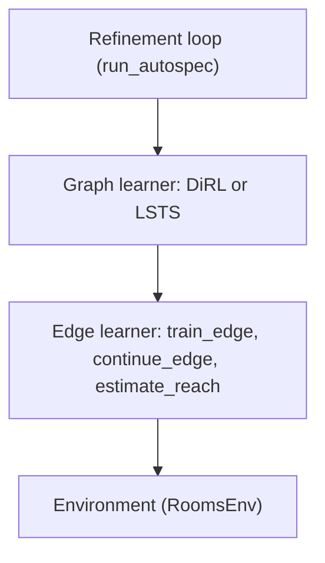

# FaultLine

FaultLine is a benchmark for specification repair. It checks whether AutoSpec
finds the **correct** repair, not only a repair that raises the success rate.

## Summary

- **What it is.** A from-scratch, tested implementation of the AutoSpec
  pipeline, plus a benchmark that measures repair quality.
- **Why it matters.** AutoSpec reports only end-to-end task success. An agent
  can raise success by shrinking a target region until the task becomes
  trivial. A high success rate does not prove a correct repair.
- **How FaultLine tests this.** FaultLine injects a known fault into a SpectRL
  specification. It records the ground-truth repair. Then it measures how close
  AutoSpec gets to that repair.
- **Status.** The SpectRL front end, the abstract-graph compiler, the 9-rooms
  environment, the learners, the four refinement operators, the Algorithm 1 loop,
  and the five-scenario 9-rooms validation are complete and tested. The FaultLine
  metrics are in progress. See [Roadmap](#roadmap).

## Goal and direction

The project studies the gap between two things:

1. A statistical success estimate from rollouts.
2. True correctness of a specification.

AutoSpec keeps soundness. If a trajectory satisfies the refined specification,
it also satisfies the original specification. FaultLine measures whether the
repair also recovers the **intended** specification. This is the core
contribution.

The code builds on the AutoSpec paper and the SpectRL language. The goal is a
solid, tested implementation that fits the research questions. We write the
code from scratch. The original authors' code stays in
[`autospec-original-code/`](autospec-original-code) as a read-only reference.

## Research questions

- **RQ1 (core).** Given a specification with a known injected flaw, does
  AutoSpec recover the correct repair?
  *Metrics:* recovery closeness per fault type, and operator selection
  accuracy.
- **RQ2 (extension).** Can failure statistics from rollout trajectories predict
  which repair operator will succeed? This would remove the sequential operator
  search.
  *Features:* failure locality (start, mid-path, goal) and failure
  concentration (trajectory variance, state entropy).
- **RQ3 (extension).** Can a lower confidence bound replace the point estimate
  `p`? The aim is fewer rollouts with a strict false-acceptance ceiling.

## What works now

| Part | State | Location |
| --- | --- | --- |
| SpectRL predicates and AST | Done | [`faultline/spectrl/`](faultline/spectrl) |
| SpectRL parser and printer | Done | [`parser.py`](faultline/spectrl/parser.py:1), [`printer.py`](faultline/spectrl/printer.py:1) |
| Reference specification semantics | Done | [`semantics.py`](faultline/spectrl/semantics.py:1) |
| Abstract graph and compiler | Done | [`faultline/graph/`](faultline/graph) |
| Graph semantics and best-path product | Done | [`graph/semantics.py`](faultline/graph/semantics.py:1) |
| 9-rooms layout and environment | Done | [`faultline/envs/`](faultline/envs) |
| Learner protocol, tabular and PPO learners | Done | [`faultline/learners/`](faultline/learners) |
| DiRL and LSTS graph-level learners | Done | [`dirl.py`](faultline/learners/dirl.py:1), [`lsts.py`](faultline/learners/lsts.py:1) |
| The four refinement operators | Done | [`faultline/refinement/`](faultline/refinement), [`faultline/geometry/`](faultline/geometry) |
| Algorithm 1 loop | Done | [`refinement/loop.py`](faultline/refinement/loop.py:1) |
| 9-rooms validation scenarios and runner | Done | [`faultline/scenarios/`](faultline/scenarios) |
| 9-rooms PPO reporting run | Done | [`faultline/experiments/`](faultline/experiments) |
| FaultLine metrics | In progress | planned |

The default test suite has 185 tests and all pass. Five further PPO acceptance
tests run under the `slow` marker; see [Run the tests](#run-the-tests).

## Requirements

- Python 3.13 or newer. The file [`.python-version`](.python-version:1) pins the
  version.
- [uv](https://docs.astral.sh/uv/) for the environment and the commands.
- Node.js only if you want the TypeScript/JavaScript half of the linter.

Core dependencies add NumPy and Gymnasium. The optional `interop` extra adds
Stable-Baselines3 and scikit-learn for the real PPO learner, and the optional
`reports` extra adds matplotlib for the figures. The test suite runs without either
extra; the PPO learner tests and the figure tests then skip.

## Install

Run this command from the project root:

```bash
uv sync --extra dev
```

Add the `interop` extra when you work on the environment or the PPO learner, and
the `reports` extra when you run the 9-rooms report:

```bash
uv sync --extra dev --extra interop --extra reports
```

## Run the tests

Run the full test suite:

```bash
uv run --extra dev pytest
```

Run one test file:

```bash
uv run --extra dev pytest tests/test_compiler.py
```

Run one test by name:

```bash
uv run --extra dev pytest tests/test_parser.py -k round_trip
```

The 9-rooms PPO acceptance tests train a policy per edge, so they are marked
`slow` and excluded from the default run. Add the `interop` extra and select them
explicitly:

```bash
uv run --extra dev --extra interop pytest -m slow
```

The centrepiece test is
[`test_compiled_graph_agrees_with_spec_semantics`](tests/test_compiler.py:47).
It checks every trajectory in a small state space. For each trajectory, the
compiled graph must accept the trajectory if and only if the specification
semantics accept it. This is the paper property `zeta models phi` if and only
if `zeta models G`.

## Run the 9-rooms report

[`faultline/experiments/rooms9_report.py`](faultline/experiments/rooms9_report.py:1)
is a runnable pipeline that trains the five 9-rooms scenarios with PPO and writes
comparison figures against the paper's numbers:

```bash
uv run --extra interop --extra reports python -m faultline.experiments.rooms9_report
```

Defaults match the paper: a 200k-step budget for every scenario, 1000 evaluation
rollouts, checkpoints every 10k steps, and seeds 0-4. Training is expensive, so
`--budget`, `--rollouts`, `--interval`, `--intermediate-rollouts`, `--seeds`,
`--workers`, `--steps`, and `--output` are flags, and `--plot-only` redraws the
figures from the persisted data without retraining.

The independent `(scenario, seed)` jobs run concurrently by default. Steps 1 and 2
each dispatch their jobs to a process pool sized to `--workers`, which defaults to
`FAULTLINE_WORKERS` or `os.cpu_count() - 1` (one core stays free for the OS and the
orchestration loop); pass `--workers 1` for a serial run. Each worker is pinned to a
single compute thread (`OMP_NUM_THREADS`, `MKL_NUM_THREADS`, and
`torch.set_num_threads(1)`), so N workers run N distinct jobs instead of
oversubscribing the cores with internal threads. Jobs share no state, and a
concurrent run produces byte-identical records to a serial one. The pool prints one
`[done] scenario=<name> seed=<n> (k/N)` line per finished job, which is the progress
report while the workers run; a serial run also shows the per-edge tqdm bars.

Profiling showed the run is dominated by the per-checkpoint rollout evaluation,
not PPO itself. The two checkpoints the paper is compared at, the 80k reference
step and the final budget, keep the full `--rollouts` (1000) count; every other
checkpoint uses `--intermediate-rollouts` (100 by default), which only shapes the
curve. Evaluation also drops the redundant per-step `set_training_mode` call
Stable-Baselines3's `predict` makes (about a quarter of one evaluation): the policy
is switched to evaluation mode once, then rolled out through the same prediction
path ([`greedy_action_fn`](faultline/learners/ppo.py:78)), which a bit-for-bit test
pins to `predict`. The run prints a stage banner per scenario, the edge regions it
inspects, and one line per checkpoint with its success and rollout count.

The run writes raw records to `reports/rooms9/data/` (`step1_<scenario>.json`
checkpoint series and `step2_<scenario>.json` per-seed summaries) and draws the
figures into `reports/rooms9/figures/` through [`faultline/viz`](faultline/viz); see
[Figures](#figures).

## Run the full AutoSpec loop on the 9-rooms scenarios

[`faultline/experiments/rooms9_autospec.py`](faultline/experiments/rooms9_autospec.py:1)
is a runnable pipeline that runs Algorithm 1 end to end on the five 9-rooms
scenarios. Where the report above applies each scenario's expected operator to a
single bottleneck edge, this trains every edge, scans the graph in topological
order, tries `SeqRefine`, `AddRefine`, `PastRefine`, and `OrRefine` on each weak
edge, and commits the first candidate that clears the success threshold:

```bash
uv run --extra interop --extra reports python -m faultline.experiments.rooms9_autospec
```

Defaults mirror the report: a 200k-step budget per edge, 1000 evaluation
rollouts, seeds 0-4, all five scenarios, and the threshold, budget, and rollouts
from [`AutoSpecConfig`](faultline/refinement/loop.py:1). A run that does not need
the learning curves skips the intermediate checkpoints, so only the final
full-rollout evaluation runs per edge.

Useful flags:

- `--scenarios` and `--seeds` restrict the batch, for example
  `--scenarios rooms9_trap --seeds 0 1`.
- `--threshold`, `--budget`, `--rollouts`, and `--avoid-tail` set the
  hyperparameters.
- `--curves` records intermediate checkpoints, which the learning-curve figures
  need; `--interval` and `--intermediate-rollouts` tune their cost. The other
  figures are drawn either way, and the curve figures are skipped with a note when
  the curves were not recorded.
- `--workers` sets the process-pool size, `--resume` skips runs whose data file
  already exists, and `--plot-only` rebuilds the table and figures from the
  persisted data without retraining.
- `--verbose` shows every worker checkpoint line instead of only the
  `[done] scenario=... seed=... operators=... best_path ... (k/N)` progress
  lines.
- `--output` changes the output directory, which defaults to
  `reports/rooms9_autospec/`.

Every `(scenario, seed)` run shares one process pool, one task per edge
training, so all scenarios and seeds train concurrently and a finished run is
persisted immediately in `reports/rooms9_autospec/data/autospec_<scenario>_seed<k>.json`.
When the batch finishes, the script prints and writes
`reports/rooms9_autospec/summary.md`, a Markdown table with one row per scenario:
the expected and matched operator, the mean best-path success before and after
refinement, the paper's reference values, and the mean run time. It also draws the
figures into `reports/rooms9_autospec/figures/`. The table fields come from
[`faultline/experiments/autospec/`](faultline/experiments/autospec).

## Figures

Figures are drawn by [`faultline/viz`](faultline/viz) from the saved data, never from
a live run, so any run can be redrawn without retraining. Both runs above draw their
figures when they finish, and `--plot-only` redraws them. To draw from any data
directory directly:

```bash
uv run --extra reports python -m faultline.viz reports/rooms9/data
uv run --extra reports python -m faultline.viz reports/rooms9_autospec/data \
    --scenario narrow_door --seed 0 1 --per-step --embed-caption
```

The command recognises each file by its contents (a full-loop report, a toy
`step1_*` report, or a toy `step2_*` summary), writes PDF and PNG plus a
`<name>.caption.txt` per figure into `<data>/../figures` (or `--output`), and prints a
note for every figure the data cannot support. `--figures` picks the kinds,
`--scenario` and `--seed` filter, `--per-step` adds one overlay panel per refinement
step, and `--embed-caption` also prints the caption under the figure.

| Figure | Shows | Needs |
|---|---|---|
| `overlay_<scenario>_seed<k>` | The room, each applied refinement (shrunk region, removed unsafe area, split boundary, new region, new edge), and the sampled rollouts before and after | Recorded geometry: a current full-loop report, or a toy `step1` report with its saved operator points |
| `curves_<scenario>`, `curves_all` | Best-path success against training steps, with the seeds, the success threshold, and the paper's value at 80k | More than one checkpoint (`--curves` for the full loop) |
| `seeds_<scenario>`, `seeds_all` | Each seed's success before and after at 80k and at the final budget | At least two seeds |
| `reference_comparison` | The paper's numbers beside this run's mean at 80k | The paper's numbers, which the five catalogue scenarios carry |

The room is drawn from the scenario's layout, so the overlay works for any room, and
the annotations follow the shape of the edit, so several refinements on one room are
all drawn. A toy `rooms9_report` run has no refined graph on disk; its overlay is
rebuilt by replaying the real operator on the points the run saved
([`faultline/viz/replay.py`](faultline/viz/replay.py:1)). Reports written before the
figure data was recorded (schema version 1) still give curves, the comparison and the
per-seed figure; their overlay is skipped.

## Run the linter

The linter is `code-check`. Install it once as a tool:

```bash
uv tool install ./linting
```

Then check the files you changed:

```bash
code-check faultline tests
```

Re-install the tool after you edit anything under [`linting/`](linting). See
[`linting/README.md`](linting/README.md:1) for details.

## Use the library

The example below parses a specification, compiles it to an abstract graph, and
checks a trajectory.

```python
from faultline.spectrl import parse, to_spectrl
from faultline.spectrl.predicates import Box
from faultline.graph import compile_spec, models_trajectory

# Name each region. A predicate is a boolean function over a state vector.
regions = {
    "start": Box((1.0, 1.0), (6.0, 6.0)),
    "goal": Box((17.0, 17.0), (23.0, 23.0)),
}

# Parse SpectRL text into an AST.
spec = parse("achieve start ; achieve goal", regions)
print(to_spectrl(spec))

# Compile the AST into an abstract graph.
graph = compile_spec(spec, source_region=regions["start"])
print(graph)

# Check one trajectory against the graph.
trajectory = [[3.0, 3.0], [10.0, 10.0], [20.0, 20.0]]
print(models_trajectory(graph, trajectory))
```

Notes on the syntax:

- The operators `;`, `ensuring`, and `or` apply to specifications.
- The operators `∧`, `∨`, and `¬` apply to predicates. You can also write `&`,
  `|`, and `!`.
- A bare name resolves through the region mapping. For example, `start`.
- You can also write a region inline. For example, `Rect(0, 0, 6, 6)`.

## Project structure

```text
faultline/
  spectrl/            SpectRL language: predicates, AST, parser, printer, semantics
  graph/              abstract graph, compiler, graph semantics
  geometry/           convex hulls, region algebra, and half-plane partitioning
  envs/               9-rooms layout and the gymnasium environment
  learners/           learner protocol, tabular and PPO learners, DiRL and LSTS
  refinement/         the Algorithm 1 loop and the four refinement operators
  scenarios/          the five 9-rooms validation scenarios and the runner
  experiments/        the runnable 9-rooms report and the full AutoSpec loop batch
  viz/                figures drawn from saved run data, and `python -m faultline.viz`
tests/                unit tests for the packages above
plans/                the implementation plan
reports/              generated report artifacts (figures and raw series)
linting/              code-check, the custom linter
autospec-original-code/   the original AutoSpec code, read only
AutoSpec_research_paper.md   implementation notes on the AutoSpec paper
```

Each module maps to a section of
[`AutoSpec_research_paper.md`](AutoSpec_research_paper.md:1):

| Module | Paper section | Content |
| --- | --- | --- |
| [`faultline/spectrl/predicates.py`](faultline/spectrl/predicates.py:1) | 2.2 | Predicates: region atoms and boolean combinators |
| [`faultline/spectrl/ast.py`](faultline/spectrl/ast.py:1) | 2.2 | Specification formulas: `achieve`, `ensuring`, sequence, choice |
| [`faultline/spectrl/parser.py`](faultline/spectrl/parser.py:1) | 2.2 | Text to AST parser |
| [`faultline/spectrl/semantics.py`](faultline/spectrl/semantics.py:1) | 2.2 | Reference semantics for a specification |
| [`faultline/graph/abstract_graph.py`](faultline/graph/abstract_graph.py:1) | 2.3 | The graph `G = (V, E, beta, s, t)` |
| [`faultline/graph/compiler.py`](faultline/graph/compiler.py:1) | 2.3 | Compiler from AST to graph |
| [`faultline/graph/semantics.py`](faultline/graph/semantics.py:1) | 2.3, 6.2 | Trajectory satisfaction and best-path success |
| [`faultline/envs/layout.py`](faultline/envs/layout.py:1) | 8 | The 3x3 room grid, walls, doors, and regions |
| [`faultline/envs/rooms9.py`](faultline/envs/rooms9.py:1) | 8 | The point-mass environment with reach-avoid subgoals |
| [`faultline/learners/tabular.py`](faultline/learners/tabular.py:1) | 3, 4 | The fast deterministic planner learner for tests |
| [`faultline/learners/ppo.py`](faultline/learners/ppo.py:1) | 6.1 | The Stable-Baselines3 PPO edge learner |
| [`faultline/learners/graph.py`](faultline/learners/graph.py:1) | 6 | The `GraphLearner` protocol and the `EdgeTraining` record |
| [`faultline/learners/dirl.py`](faultline/learners/dirl.py:1) | 6 | DiRL: Dijkstra-style lazy edge learning |
| [`faultline/learners/lsts.py`](faultline/learners/lsts.py:1) | 6 | LSTS: teacher-driven dynamic task sampling |
| [`faultline/learners/start_distribution.py`](faultline/learners/start_distribution.py:1) | 6 | Environment wrapper that resets from an empirical start set |
| [`faultline/refinement/operators.py`](faultline/refinement/operators.py:1) | 4 | The four refinement operators |
| [`faultline/refinement/loop.py`](faultline/refinement/loop.py:1) | 3 | The Algorithm 1 refinement loop, config, and run record |
| [`faultline/scenarios/catalogue.py`](faultline/scenarios/catalogue.py:1) | 8, 11 | The five 9-rooms validation scenarios |
| [`faultline/scenarios/runner.py`](faultline/scenarios/runner.py:1) | 3, 11 | The scenario runner and its per-edge report |
| [`faultline/experiments/pipeline.py`](faultline/experiments/pipeline.py:1) | 3, 11 | The single-seed and multi-seed checkpointed pipeline |
| [`faultline/viz/`](faultline/viz) | 11 | Room, overlay, learning-curve, per-seed, and paper-comparison figures |
| [`faultline/refinement/trace.py`](faultline/refinement/trace.py:1) | 3 | What each committed refinement changed, recorded for the figures |

## How the pipeline works


One step follows the next.

1. The parser reads SpectRL text. It returns an AST.
2. The compiler walks the AST. It builds an abstract graph.
3. Each graph edge is a reach-avoid subgoal. A separate policy learns each
   edge.
4. The refinement loop finds a weak edge. It applies one operator. Then it
   repeats.
5. The graph semantics checks a trajectory. The best-path product gives the
   whole-task success.

## DiRL and LSTS graph learners

AutoSpec does not say how to learn the policies on the abstract graph. By
default the loop trains **every** edge with the edge learner. DiRL and LSTS are
two published strategies that decide **which edges to learn, in what order, and
with how much training**. They sit above the edge learner (`PPOEdgeLearner` or
`TabularLearner`) and below the refinement loop.



Both implement the `GraphLearner` protocol in
[`graph.py`](faultline/learners/graph.py:1):

```python
learn_graph(graph, env, edge_learner, budget, n_rollouts, seed) -> tuple[EdgeTraining, ...]
```

Each `EdgeTraining` holds an edge, its policy, and its `EdgeEstimate`. Edges the
strategy never trained are absent from the result.

### DiRL

DiRL is from Jothimurugan et al., *Compositional Reinforcement Learning from
Logical Specifications*, NeurIPS 2021. It runs Dijkstra's algorithm over the
abstract graph and learns edges lazily.

1. Give the source vertex cost 0 and every other vertex cost infinity.
2. Pick the unprocessed vertex with the lowest cost. Stop when that vertex is
   the target, or when none is reachable.
3. Train and evaluate every edge that leaves that vertex. The edge cost is
   `-log(p)`, where `p` is the edge's success probability. A floor of `1e-12`
   on `p` keeps the cost finite.
4. If the path through this edge is cheaper than the best known path to the
   edge's target, record it. Dijkstra's shortest path with these costs is the
   path with the highest product of success probabilities.

The key idea is the **induced start distribution**. An edge `u -> v` is trained
from where the best path reached `u`, not from anywhere in `u`'s region. DiRL
keeps the end positions of the successful rollouts of the chosen incoming edge.
It approximates the distribution at the target vertex by these positions. The
outgoing edges of that vertex then train from them. The source vertex has no
incoming edge, so it trains from its own region.

[`StartDistributionWrapper`](faultline/learners/start_distribution.py:1)
implements this. On each reset it draws one stored position and passes it to the
environment as `options["start"]`.

DiRL only trains edges whose source vertex it processed. Edges behind a vertex
that the search never reached stay untrained. Every trained edge gets the full
`budget`.

### LSTS

LSTS is *Logical Specifications-guided Dynamic Task Sampling*. A **teacher**
splits one training budget across several **tasks**, which are the edges of the
graph. The student is the edge learner.

1. Keep only edges that lie on some path to the target. Dead ends never get
   training.
2. Start with the edges that leave the source as the **active** set.
3. Each round, the teacher picks one active edge:
   - An edge that was never picked goes first, in name order.
   - Otherwise, with probability `epsilon` it picks a random active edge.
   - Otherwise it picks the active edge with the highest Q-value.
4. The student trains that edge for one chunk of `chunk_size` steps. The first
   chunk calls `train_edge`. Later chunks call `continue_edge`, which keeps the
   same network and optimiser state.
5. Evaluate the edge with `n_rollouts` rollouts. Update its Q-value:
   `Q <- alpha * score + (1 - alpha) * Q`.
6. An edge **converges** when its success is at least `threshold` and it moved
   by less than `tolerance` since its previous evaluation. A converged edge
   leaves the active set. The edges that leave its target vertex join it.
7. Stop when the total budget is spent, when no edge is active, or when an edge
   that reaches the target converges.

| Parameter | Default | Meaning |
| --- | --- | --- |
| `epsilon` | 0.2 | Chance of a random pick instead of the best Q-value |
| `alpha` | 0.1 | Weight of the newest score in the Q-value |
| `threshold` | 0.99 | Success needed before an edge can converge |
| `tolerance` | 0.01 | Largest score change that still counts as stable |
| `chunk_size` | 5000 | Environment steps per teacher round |
| `max_interactions` | `None` | Total step budget; `None` uses the loop's `budget` |

LSTS needs an edge learner with `continue_edge`. `PPOEdgeLearner` has it.
`TabularLearner` does not, so LSTS rejects it with a `TypeError`.

### How they differ

| | Default loop | DiRL | LSTS |
| --- | --- | --- | --- |
| Edges trained | All | Only edges leaving processed vertices | Active edges on a path to the target |
| Budget per edge | Full `budget` | Full `budget` | Chunks from one shared budget |
| Start states | The edge's source region | Where the best path arrived | The edge's source region |
| Needs | `train_edge`, `estimate_reach` | Same | Also `continue_edge` |

### Use them with the AutoSpec loop

Pass a graph learner to `run_autospec` or `run_scenario`:

```python
from faultline.learners import DiRL, LSTS, PPOEdgeLearner
from faultline.refinement import AutoSpecConfig, run_autospec

run = run_autospec(
    graph,
    env,
    PPOEdgeLearner(),
    AutoSpecConfig(),
    graph_learner=DiRL(),  # or LSTS(chunk_size=5_000)
)
```

With a graph learner, the loop changes in three ways.

- It learns the initial graph with `learn_graph` instead of training every edge.
- An edge the graph learner skipped has no policy. Algorithm 1 treats its
  policy as null. The refinement scan skips it. `initial_edge_success` records
  `None` for it, and the final record uses `0.0`.
- After a refinement commits, the loop runs the graph learner again on the new
  graph. It does not train the new edges one by one, because the graph learner
  chooses which of them to learn.

Without a graph learner, nothing changes.

To try DiRL without the PPO extra, run
`PYTHONPATH=. uv run python scripts/small_smoke_dirl.py`. The script is at
[`scripts/small_smoke_dirl.py`](scripts/small_smoke_dirl.py:1). It uses the
tabular learner on the `blocked_two_path` scenario and prints each learned
edge's success probability.

## Fault taxonomy

Each fault targets one primitive. The ground-truth repair is known by
construction.

| Fault | Target primitive | Expected operator | Metric |
| --- | --- | --- | --- |
| Trap in the goal region | Predicate | `SeqRefine`, `ReachRefine` | Region IoU, wIoU |
| Over-wide safety region | Predicate | `SeqRefine`, `AvoidRefine` | Region IoU, wIoU |
| Unreachable start states | Predicate | `PastRefine` | Region IoU, wIoU |
| Missing waypoint | Graph topology | `AddRefine` | Normalized graph edit distance |
| Missing alternative path | Graph topology | `OrRefine` | Normalized graph edit distance |

Faults come in several severity levels. Control specifications have no fault.
They check that AutoSpec does not repair a valid specification.

## Metrics

- **IoU.** The overlap between the refined region and the ground-truth region,
  divided by their union.
- **wIoU.** The same overlap, weighted by how often the agent visits each
  state.
- **Normalized graph edit distance.** The number of vertex and edge changes
  that map the repaired graph to the ground-truth graph, divided by the size of
  the ground-truth graph.
- **Operator accuracy.** The fraction of runs that select the ground-truth
  operator.
- **Soundness.** The check that a refined region stays inside the original
  region and respects the safety envelope.

The benchmark compares AutoSpec with three baselines: the unrefined
specification, a uniform-random operator selector, and an oracle selector that
applies the intended repair.

## Roadmap

Work continues in this order.

1. FaultLine metrics: IoU, wIoU, and graph edit distance.
2. Fault-injection helpers and the ground-truth repair encoder.

If time runs short, drop RQ3 first, then RQ2. RQ1 is the core and stands alone.

## Related work

- **AutoSpec** refines SpectRL specifications over an abstract graph. It uses
  four sound operators: `SeqRefine`, `PastRefine`, `AddRefine`, and
  `OrRefine`. It evaluates only rollout success.
- **Specification gaming** shows how a proxy objective leads to unintended
  solutions.
- **Fault injection** uses a database of known faults for controlled studies.
  For example, Defects4J.
- **Verified AI and confidence intervals** motivate statistical guarantees.
  For example, the Clopper-Pearson interval.

## References

- Ambadkar, T., Žikić, Đ., and Verma, A. (2026). *Automating the Refinement of
  Reinforcement Learning Specifications.* ICLR. arXiv:2512.01047.
- Jothimurugan, K., Alur, R., and Bastani, O. (2021). *A Composable
  Specification Language for Reinforcement Learning Tasks.* NeurIPS.
  arXiv:2008.09293.
- Clopper, C. J., and Pearson, E. S. (1934). *The use of confidence or fiducial
  limits illustrated in the case of the binomial.* Biometrika, 26(4), 404-413.
- Just, R., Jalali, D., and Ernst, M. D. (2014). *Defects4J.* ISSTA, 437-440.
- Krakovna, V., et al. (2020). *Specification gaming: the flip side of AI
  ingenuity.* DeepMind Blog.
- Seshia, S. A., Sadigh, D., and Sastry, S. S. (2022). *Toward Verified
  Artificial Intelligence.* Communications of the ACM, 65(7), 46-55.

## Authors

- Alexander van den Arend Schmidt, TU Delft,
  `A.F.vandenArendSchmidt@student.tudelft.nl`
- Petre-Alexandru Hautelman, TU Delft,
  `p.a.hautelman-1@student.tudelft.nl`
