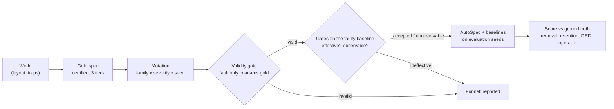

# 3. Method

FaultLine evaluates a repair method with a controlled experiment:

Everything that can be fixed in advance (threshold, budgets, seeds, gate thresholds, severity grid, metric
resolution) is frozen in [`configs/protocol.toml`](../../configs/protocol.toml). The SHA-256 of that file is stamped
on every certificate and result record, so a number can always be traced to its settings.

## 3.1 Environment

`RoomsEnv` ([`faultline/envs/rooms/env.py`](../../faultline/envs/rooms/env.py)) is a continuous room grid with
point-mass dynamics: state `(x, y, θ, d)` (position, heading and distance to the episode's goal point), action
`(v, θ)` with speed up to 2 per step; a move through a wall leaves the agent in place. An edge episode samples a start
in the source region and a goal *point* in the target region, and succeeds when the agent comes within 1.0 of that
point without leaving the safe set. Sampling the goal point is what makes an unreachable part of a target region show
up as a lower success rate. Reward: +10 on success, -10 on a violation (terminal), -0.01 per step plus progress
shaping. A **trap** is a physical absorbing region: entering it ends the episode as a violation whatever the
specification says. Gold and faulty specifications share one environment (`golden/env.py`).

**rooms9** is the 3x3 grid of the AutoSpec paper (24 x 24 units, 8-unit rooms) with hand-built door sets
(`envs/layout.py`); FaultLine uses `mixed_star` and `blocked_two_path`. **rooms100** (10x10 rooms) worlds come from the
paper's procedural generator ([`envs/rooms/generator.py`](../../faultline/envs/rooms/generator.py), paper appendix
A.3.3-A.3.4): Start and Goal 2x2-room blocks in opposite corners (one of four orientations), the intermediate blocks
M1-M5 placed uniformly among non-overlapping 2x2 positions, every adjacent room pair joined by a full-width door with
probability 0.5, and the draw repeated until a Start-to-Goal route through the specification's DAG exists
(`verify.py`). Five generated worlds (`random_seed0..4`) and the paper's two figures (`fig3`, `fig6`) are frozen as
JSON in `envs/rooms/data/`, so results do not move when the generator changes (a test checks the generator still
reproduces them). Their specification is the paper's
`achieve Start ; (achieve M1 or achieve M2) ; achieve M3 ; (achieve M4 or achieve M5) ; achieve Goal`: reach-only,
two binary choices, no safety clause (`hazards = ()`), compiled to the 8-edge DAG
`Start → {M1, M2} → M3 → {M4, M5} → Goal`.

## 3.2 Gold specifications and certification

A gold specification is the *intended* task for a world. FaultLine builds it rather than taking the paper's
specification, because a fault is only meaningful relative to a specification that is known to be right and
learnable. Construction (`benchmark/golds.py`, `golden/builder.py`): take the shortest door path from the start room
to the goal room and put a waypoint box (0.375 of a room side) in every intermediate room, so every edge is a
**one-room hop**; start and goal boxes are 0.75 of a room side; horizon 30 steps. Variants add a physical trap strip
on the route (`_trap`) or a weak-by-design shortcut edge that skips one waypoint across a wall (`_shortcut`, the
site route-pruning faults need).

A gold is used only if it passes three tiers (`golden/builder.py`, `golden/certify.py`):

1. **Feasibility (exact).** On a 0.1-unit cell grid, every region keeps at least half its area after removing cells
   that cannot reach the next region or cannot be reached from the previous one, and every edge fits the horizon.
2. **Learnability.** On each of 5 certification seeds, DiRL with PPO learns every non-weak edge with a one-sided 95%
   Clopper-Pearson lower bound of at least `p_gold_min = 0.85` (over 1000 rollouts), above the refinement threshold
   `p = 0.8`. A weak-by-design edge instead needs an alternative route whose edges reach 0.95.
3. **Fixpoint.** On each of 5 held-out seeds, Algorithm 1 run on gold commits no refinement on a non-weak edge.

Certification is evidence under the protocol, not proof. The golds were chosen after pilots: one-room hops (longer
edges did not certify), horizon 30, and the `default` layout was excluded after it failed Tier 2 twice (once with
smaller end boxes). Results of all certification runs are in
[`reports/faultline_v1/certificates.json`](../../reports/faultline_v1/certificates.json); five rooms9 golds certified.

## 3.3 Fault families

A mutation is a deterministic function `(gold, params, rng) → (faulty spec, ground-truth repair)`
(`faults/mutations.py`); the rng is derived from the instance id, so generation is order independent. Each family
targets one operator, and its severity changes the geometry:

| Family | Fault | Expected operator | Severity |
|---|---|---|---|
| Goal inflation | add a *sealed pocket* (cells no in-edge can reach) to a target region; goals sampled there are unreachable | ReachRefine (SeqRefine) | pocket mass 10 / 25 / 50% of the region |
| Hazard unlabeled | label only the far part of a physical trap unsafe; the approach part is missing from the spec | AvoidRefine (SeqRefine) | unlabelled fraction 25 / 50 / 75% |
| Dead start | add start cells from which the outgoing edge cannot succeed | PastRefine | pocket mass 10 / 25 / 50% |
| Waypoint contraction | drop one or two consecutive waypoints and join their neighbours | AddRefine | position along the route (low / mid / high), 1 or 2 dropped |
| Route pruning | remove the detour that makes a weak-by-design edge avoidable | OrRefine | none (one variant) |
| Null | gold itself | none | none |

The **validity gate** (`faults/validity.py`) checks that a fault only coarsens gold: every gold region is contained in
its faulty counterpart on the cell grid, and no sampled gold-satisfying trajectory is rejected by the faulty spec.
Nulls make up at least 20% of instances, as replicates of each gold with disjoint evaluation seeds.

## 3.4 Gates and funnel

A valid fault may still be invisible to the learner. Before any evaluation run, the faulty graph's unrefined baseline
is learned on 3 gate seeds (`faults/gates.py`):

- **Effective**: on at least 80% of gate seeds, the faulty best-path success trails gold's by at least 0.15 and some
  edge falls below `p`. An ineffective fault would never trigger AutoSpec, so it measures nothing.
- **Observable**: the edges at the fault locus produce at least 20 of the samples the expected operator consumes
  (for example successful target states for ReachRefine). Unobservable faults are run and reported as their own
  stratum: AutoSpec cannot be expected to fix them.

Every generated instance lands in exactly one bucket (`not_applicable`, `invalid`, `ineffective`, `unobservable`,
`accepted`), and the per-family counts are the denominator of every claim. Hazard unlabeled is ineffective by
construction: the trap is physical, so PPO is penalised by it whatever the specification says; those instances are
reported as a separate stratum and no AvoidRefine recovery claim is made from them.

## 3.5 Metrics

All region metrics are computed on the 0.1-unit cell grid (`metrics/`):

- **Fault removal**: share of the fault's excess `R_f \ R*` that the repair removed.
- **Collateral retention**: share of the gold region `R*` the repair kept.
- **F1** of the two. Removal alone is gamed by deleting everything (retention 0), retention alone by doing nothing
  (removal 0), so only their combination measures a correct repair.
- **Attainment**: F1 relative to the *ceiling*, the best region the expected operator can produce with perfect
  witnesses, which separates operator limits from learning noise.
- **Region-aware GED**: edit distance to gold where a matched vertex costs `1 - IoU` of its region; for structural
  families, which have no region locus.
- **Trajectory audit**: share of gold trajectories the repair still accepts and of fault-only trajectories it now
  rejects (language-level retention and removal).
- **Operator match**: the first operator committed on an edge touching the locus is the family's expected one.
- **False repair** (nulls): any refinement committed on gold.
- **Proxy success**: best-path success ≥ `p`, what AutoSpec itself optimises.

Baselines: **unrefined** (faulty spec as is), **random operator** (Algorithm 1 with a random operator order, the same
loop otherwise), **oracle** (the ceiling repair, or gold for structural families) and **trivializer** (source and
target shrunk to tiny boxes inside gold: high proxy success, near-zero retention). Statistics: Clopper-Pearson 95% for
rates, bootstrap 95% intervals over instances (seeds averaged within an instance), paired Wilcoxon signed-rank
AutoSpec vs random operator per family with Holm correction (`metrics/inference.py`).

## 3.6 Exact edge-estimate cache

Training one PPO edge takes about 15 s and dominates the cost, yet the same edge is trained many times: the gate
baseline, AutoSpec's first phase and the random-operator baseline's first phase are identical for the same seed, the
random-operator baseline scores candidates AutoSpec already scored, and every worker used to relearn the gold
baselines. Training is deterministic given the environment, the edge, the budget, the PPO recipe and the seed
(Stable-Baselines3 reseeds the environment at the start of `learn`, and every evaluation episode is reseeded), so the
estimate is a pure function of these inputs. `CachedLearner` (`learners/cache.py`) keys each estimate by an exact
fingerprint of all of them (floats by their bit pattern, plus DiRL's start states and the library versions) and
stores the rollouts losslessly on disk, shared between processes. A cache hit returns exactly what retraining would:
`tests/test_edge_cache.py` checks that a full AutoSpec run with DiRL and PPO is identical with no cache, a cold cache
and a warm cache. `CACHE_VERSION` must be bumped whenever the environment, the reward or the learner code changes.

This cache is unrelated to `AutoSpecConfig.reuse_candidate_cache`. That option changes the *method*: after a commit
it keeps the policies trained while scoring the committed candidate instead of rerunning DiRL on the refined graph,
so the final estimates rest on different evidence (uniform-start candidate training instead of DiRL's induced starts,
see the [appendix](appendix-rl-review.md), finding 8). It exists only as an ablation and is off in the benchmark.

## 3.7 RQ2 data

Every benchmark run logs, per instance, `rq2/<instance>.jsonl` plus content-addressed rollout files
(`faultline/rq2/log.py`). One row per (phase, seed, edge):

| Phase | What | Labels |
|---|---|---|
| `gold` | gold baseline on a gate seed | negatives (`fault_kind = none`) |
| `gate` | faulty baseline on a gate seed | fault kind, locus, expected operator |
| `initial` | AutoSpec first phase on an evaluation seed | same |
| `decision` | a weak edge the loop examined, with the estimate it refined from | plus the score of **all four** operators |

During a decision the loop scores operators in its fixed order and commits the first one above `p`. To give every
decision row the full label vector, an observer scores the operators the loop skipped *after* the loop has decided,
against the same graph and cache; this costs training but changes nothing the loop returns (tested). Rows carry the
edge geometry (boxes, length, wall crossing, distance to the trap) and point to the full rollouts. Features are
computed offline (`faultline/rq2/features.py`, `scripts/rq2_dataset.py`): where along the edge failures end (start,
middle or goal third), failures inside the target box, success gap between quadrants of the source box,
violation / timeout / stuck fractions, entropy and spread of failure end points. Targets: `operators_clearing`
(multi-label: which operators would fix the edge), `committed_operator`, `fault_kind`, `touches_locus`.
