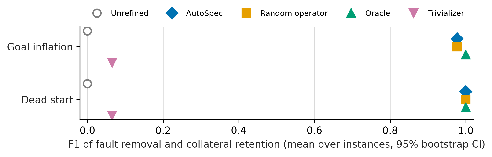
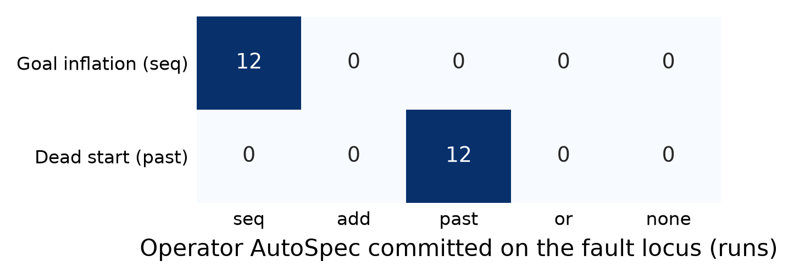

# 4. Preliminary results

**Status: preliminary.** The numbers below come from a deliberately small run on the certified rooms9 golds
(instance seed 0, medium and high severity plus nulls, evaluation seeds 0-2), not the full protocol grid (5 instance seeds x 5
evaluation seeds x 3 severities). They show the pipeline works end to end and indicate trends; sample sizes are given
with every number and should be read as such. Protocol hash `694b17d4`, PPO + DiRL, threshold `p = 0.8`.

## 4.1 Gold certification

Full protocol: 5 certification seeds (Tier 2), 5 held-out seeds (Tier 3), 1000 rollouts per edge, PPO + DiRL.
Weakest edge = lowest one-sided 95% Clopper-Pearson lower bound over all edges and certification seeds.

| Gold | Edges | Certified | Weakest edge (lower bound) | Note |
|---|---|---|---|---|
| `rooms9_mixed_star` | 4 | yes | `start->w1` (0.997) | |
| `rooms9_mixed_star_trap` | 4 | yes | `start->w1` (0.972) | physical trap on the route |
| `rooms9_blocked_two_path` | 8 | yes | `start->w1` (0.997) | |
| `rooms9_blocked_two_path_trap` | 8 | yes | `w1->w2` (0.992) | physical trap on the route |
| `rooms9_blocked_two_path_shortcut` | 9 | yes | `w6->w7` (0.992) | weak-by-design shortcut (route-pruning site) |
| `rooms9_mixed_star_shortcut` | 5 | no | `w3->goal` (0.0) | DiRL reached the goal via the shortcut and never trained `w3->goal` |
| `rooms9_default`, `rooms9_default_trap` | 4 | no (excluded) | `w3->goal` (0.69-0.83) | failed twice, also with smaller end boxes |

Every certified gold sits well above the refinement threshold, so a refinement on gold is a false repair, not noise
at the threshold. rooms100 golds pass Tier 1 on all seven worlds but fail Tier 2 (see the
[RL review](appendix-rl-review.md), findings 4-5) and are not used.

## 4.2 Runtime

One instance (`rooms9_mixed_star|goal_inflation|mid|0`): gold baselines (3 gate seeds), gates (3 seeds) and one
evaluation seed (AutoSpec + random-operator baseline), single core, `scripts/time_instance.py`.

| Configuration | Gold baselines | Gates | Evaluation seed | Total | Edges trained |
|---|---|---|---|---|---|
| No cache (previous code) | 189 s | 184 s | 262 s | 648 s | — |
| Cache, cold | 188 s | 48 s | 32 s | 282 s | 17 |
| Cache, warm (rerun) | 0.1 s | 0.1 s | 0.1 s | 14 s | 0 |
| Cache, cold, all operators scored (RQ2 labels) | 193 s | 49 s | 81 s | 336 s | 20 |

All four configurations produce the same result (gate accepted; AutoSpec commits `seq` on `w3->goal`, 0.742 → 1.0).
The cold-cache speed-up (2.3x per instance) comes from sharing within the instance: faulty-graph edges upstream of the
fault are identical to gold's and hit the gold baselines' entries, the evaluation seed reuses the gate's first phase
(seed 0 is both a gate and an evaluation seed), and the random-operator baseline reuses AutoSpec's candidate
trainings (17 edge trainings in total on a cold cache). Across a grid the gold baselines are learned once per
gold instead of once per worker, which removes the first column for all but one instance per gold. The warm time is
the metric computation (cell-grid scores and the trajectory audit). Scoring all four operators for RQ2 costs 19% on
this instance.

## 4.3 Screening funnel

Five certified golds, instance seed 0, all severities: 64 valid instances. The gates learn the unrefined faulty graph
on 3 gate seeds (`reports/faultline_v1/screen_funnel.json`).

| Family | Valid | Accepted | Ineffective | Notes |
|---|---|---|---|---|
| Goal inflation | 6 | 4 | 2 | the two ineffective ones are severity *low* (10% pocket): the success drop stays below the 0.15 gap |
| Dead start | 6 | 4 | 2 | same pattern: *low* severity is ineffective |
| Waypoint contraction | 30 | 0 | 30 | including the two-waypoint variant: PPO learns the joined 2-3-room edges anyway |
| Route pruning | 1 | 0 | 1 | the only site (`blocked_two_path_shortcut`) |
| Hazard unlabeled | 6 | — | — | ineffective by construction (physical trap), own stratum, not evaluated |
| Null | 13 | 13 | — | gold itself, replicates with disjoint evaluation seeds |

Goal inflation and dead start apply only to the `mixed_star` golds (on the `blocked_two_path` golds the mutation finds no
sealed pocket of the required size next to the goal or start region: `not_applicable` in `funnel.json`). **Two of the five operator families produce effective faults on the
certified rooms9 golds.** Waypoint contraction and route pruning do not: on one-room-hop golds, dropping waypoints
leaves edges PPO still learns above `p`, so AutoSpec never sees a weak edge. This is a property of the golds, not of
AutoSpec; it is reported rather than tuned (making the faults bite would mean changing golds or gates after seeing
results).

Compute: 2.4 CPU-hours of gate learning for the 64 instances (about 15 minutes on 12 workers, including the gold
baselines).

## 4.4 RQ1: recovery per family

Evaluation on the accepted instances of severities *mid* and *high* plus all nulls: 8 fault instances and 13 nulls,
evaluation seeds 0-2, 63 AutoSpec runs (and 63 random-operator runs). 46 CPU-minutes, 8 minutes wall clock on 12
workers. Full tables: `reports/faultline_v1/analysis/summary.md`.

| Family | Method | Proxy success | F1 (removal x retention) | GED to gold | Operator match |
|---|---|---|---|---|---|
| Goal inflation | AutoSpec | 12/12 [0.74, 1.00] | 0.98 [0.97, 0.98] | 0.00 | 12/12 [0.74, 1.00] |
| | Random operator | 12/12 | 0.98 [0.97, 0.98] | 0.00 | 12/12 |
| | Unrefined | — | 0.00 | 0.04 | — |
| | Oracle | — | 1.00 | 0.00 | — |
| | Trivializer | — | 0.07 | 0.21 | — |
| Dead start | AutoSpec | 12/12 [0.74, 1.00] | 1.00 [1.00, 1.00] | 0.00 | 12/12 [0.74, 1.00] |
| | Random operator | 12/12 | 1.00 | 0.00 | 12/12 |
| | Unrefined | — | 0.00 | 0.04 | — |
| | Oracle | — | 1.00 | 0.00 | — |
| | Trivializer | — | 0.07 | 0.21 | — |
| Null | AutoSpec | 39/39 [0.91, 1.00] | — | 0.00 | false repairs 0/39 [0.00, 0.09] |

n = 4 instances per fault family (F1 and GED intervals are bootstrap over instances), 12 runs per family (rates are
Clopper-Pearson 95%).

Reading:

1. **Where the fault is effective, AutoSpec recovers the intended repair, not only a successful one.** On goal
   inflation it commits SeqRefine (ReachRefine) on the inflated goal edge in every run and removes the sealed pocket
   while keeping 92-98% of the gold region (F1 0.98, attainment 1.0: the ceiling of ReachRefine with perfect witnesses). On dead start it commits
   PastRefine on the start edge and recovers the gold start region exactly. Proxy success and intended repair agree
   here, and the trivializer shows the metric would have caught a gamed repair (proxy-style shrinking to a tiny box
   scores F1 0.07).
2. **No false repairs on gold** in 39 null runs (upper bound 9%), consistent with the certified margins.
3. **Operator order does not matter on these faults.** The random-operator baseline is indistinguishable from
   AutoSpec (no paired test possible: identical F1). The RQ2 log explains why: on every one of the 24 decision rows
   exactly one operator clears `p` (SeqRefine scores 1.0 on goal inflation while AddRefine and PastRefine stay at
   0.43-0.77; PastRefine scores 1.0 on dead start while SeqRefine and AddRefine stay at 0.25-0.77). The fixed order
   only costs time: on dead start AutoSpec trains the SeqRefine and AddRefine candidates before reaching PastRefine.
4. **The interesting failure modes are not reached yet.** Families where several operators could raise success (and
   only one is the intended repair) are exactly the structural ones that are ineffective on these golds. Testing the
   "success without correctness" hypothesis needs golds with longer edges or faults that bite (future work).

## 4.5 RQ2: first look at the logged data

1194 logged edges (`rq2/dataset.csv`; gold, gate, initial and decision rows). On the weak edges at the fault locus,
one feature already separates the two effective families: the success-rate gap between quadrants of the source box
(`start_quadrant_gap`) is 1.0 on every dead-start edge and at most 0.08 on every goal-inflation edge, while
failures ending inside the target box (`fail_in_target_box`, 0.05-0.67) occur only for goal inflation. With two
effective families and 24 decision rows, this shows the features carry the intended signal; it is not yet a
classifier result.

## 4.6 Threats to validity

- **Gold selection after pilots.** One-room hops, horizon 30 and the exclusion of `default` were chosen after
  seeing learning results. They are reported; the protocol thresholds were never changed.
- **Small n.** One instance seed, three evaluation seeds, four instances per family; intervals are wide.
- **Two of five families evaluated.** Waypoint contraction and route pruning were ineffective on these golds, so
  RQ1 currently covers only the predicate-level faults.
- **Hazard unlabeled is ineffective by construction** with physical absorbing traps; no AvoidRefine claim is made.
- **Start distributions differ** between AutoSpec's commit gate (uniform starts) and DiRL's final estimate (induced
  starts); see the [appendix](appendix-rl-review.md), finding 8.
- **rooms9 only.** rooms100 is future work.
